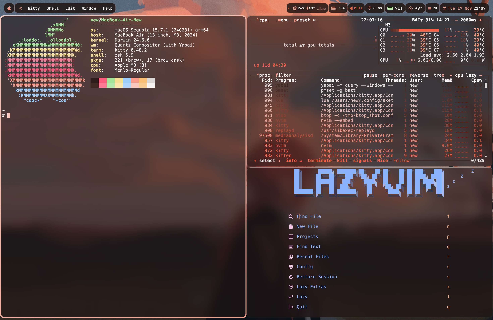
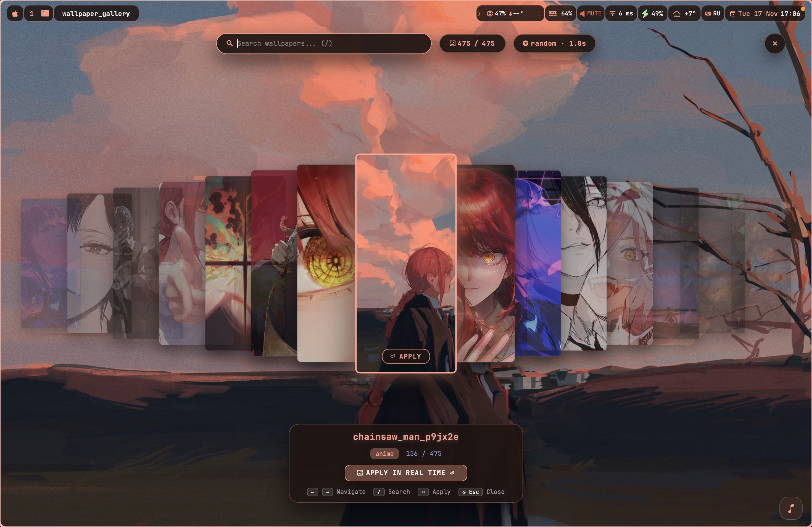
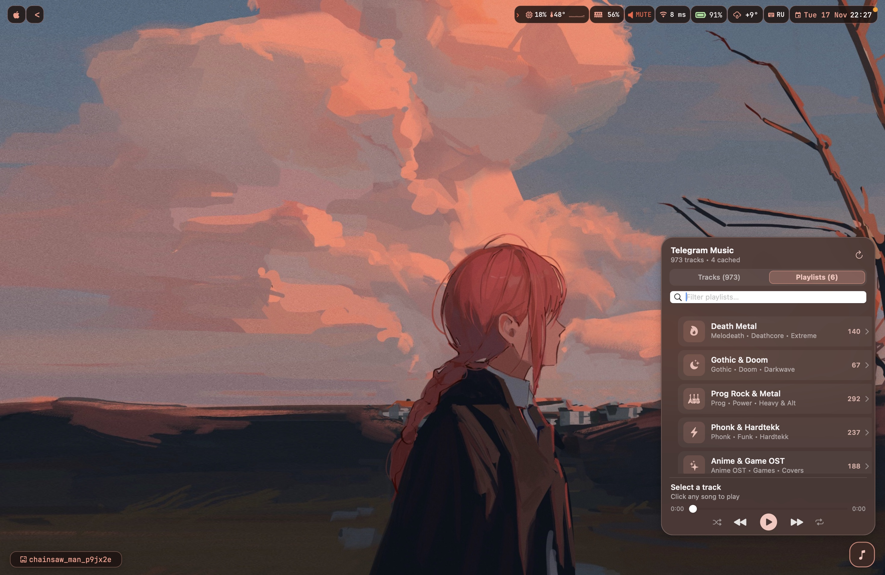
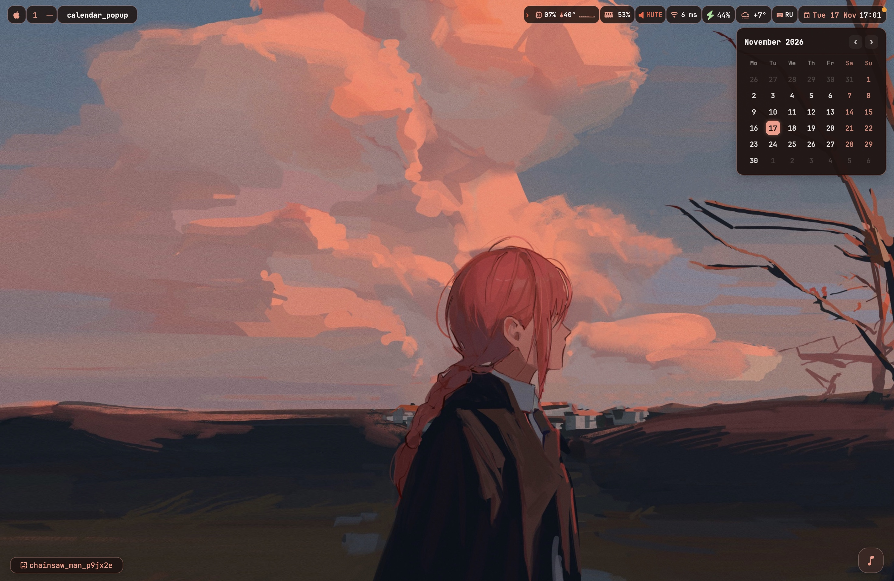
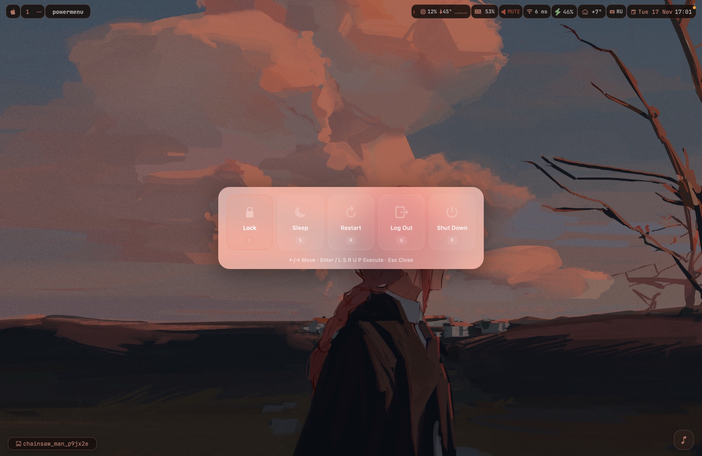

# dotfiles

My macOS setup. Tiling with `yabai`, a custom Lua `sketchybar`, `kitty`, `yazi`, and a bunch of small Swift/Python tools I built around it to make macOS feel a bit closer to a Linux Wayland rice. Default look started as a soft lavender palette, and now everything adapts automatically to whatever wallpaper or preset I switch to.

Runs on a 13" MacBook Air M3 (macOS Sequoia). Most things should work on any Apple Silicon Mac, though the notch split in the menu bar is tuned for my screen width, so you may need to nudge a couple of coordinates.



## Screenshots

| 3D Wallpaper Gallery | Telegram Music & Playlists |
| :---: | :---: |
|  |  |

| Clock Calendar Popover | PowerMenu Overlay |
| :---: | :---: |
|  |  |

## What's in here

- `sketchybar/` — the top bar in Lua, with small C helpers (`cpu_load`, `network_load`, `keyboard_load`, `menus`, `custom_menus`). Every module sits in its own rounded "island": spaces, front app, app menu bar split around the notch, CPU graph + temp, RAM, volume slider & output switcher, Wi-Fi ping/stats, battery, weather, keyboard layout, and clock. Includes a small `bar.watcher` workaround for SketchyBar v2.24.0 dropping bar windows after display sleep/wake.
- `yabai/` — BSP tiling with rules for dialogs, browser/Telegram window opacity, and scripts: `smart_zoom.py`, `smart_toggle_float.sh`, `smart_balance.py`, `window_guard.py`, and `toggle_minimize.py` (keeps a LIFO stack of minimized windows so you can pop them back without touching the Dock).
- `skhd/` — hotkeys for tiling, launchers, Yazi file picker, OCR, PowerMenu, wallpaper gallery, and volume keys.
- `wallpaper_gallery/` — 3D Coverflow wallpaper picker in Swift/AppKit + WebKit (`Alt + G`). Scans `~/wallapers` and `~/wallpapers`, applies wallpapers with Metal shader transitions, extracts colors to re-theme the desktop (or respects a locked preset), puts a small wallpaper pill in the bottom-left corner when the desktop is clear, and runs a 56-bar desktop `cava` visualizer in the bottom center (auto-stops when covered or when the gallery opens).
- `tg_music/` — corner music player in the bottom-right (`AVPlayer` + `mpv` fallback + media keys via `MPNowPlayingInfoCenter`) synced via Telethon (`tg_sync.py`) from a Telegram bot/channel library. Streams/caches tracks on demand with per-row download progress and includes a `Playlists` tab (`classify_playlists.py`) auto-sorted into *Death Metal*, *Gothic & Doom*, *Prog Rock & Metal*, *Phonk & Hardtekk*, *Anime & Game OST*, and *Other*.
- `calendar_popup/` — minimalist Swift calendar popover anchored under the top-right clock (`Mo`–`Su`, arrow/scroll/hjkl month switching, `Today` jump).
- `audio_vol/` — tiny CoreAudio CLI helper in Swift so volume keys and the bar slider still work smoothly on macOS Multi-Output devices (keeps `BlackHole 2ch` at `1.0` so `cava` never goes dead while adjusting speaker volume).
- `yazi/` — floating `Yazi Picker` window in `kitty` (`Shift + Alt + F`). Lets you select one or multiple files and copy them straight to the macOS clipboard (`Y`, `Ctrl+Y`, or `gy`) for `Cmd+V` into Telegram, browsers, etc., plus `fill_open_panel.sh` (`Shift + Alt + G`) for native file dialogs.
- `rofi/` — not real rofi (that's Linux only). Small Python popup menus for launching apps/folders (`launcher.py`), switching Wi-Fi (`wifi_menu.py`), picking theme presets (`theme_menu.py`), and adjusting window opacity (`opacity_menu.py`).
- `ocr_osd/` — screen-area OCR (`Shift + Alt + O`) using Apple Vision (`VNRecognizeTextRequest`, English + Russian) with a floating toast showing what got copied.
- `powermenu/` — floating `Lock / Sleep / Restart / Log Out / Shut Down` overlay (`Shift + Alt + P`) with single-key shortcuts (`L`, `S`, `R`, `U`, `P`) and a second-press confirmation for destructive actions.
- `lockscreen/` — Hyprlock-inspired lock overlay in Swift/WebKit with PAM + Touch ID auth, live clock, layout indicator, and media controls via `nowplaying-cli`.
- `theme/` — shared template engine (`theme.py`, `presets/*.toml`, `templates/*`). Pushes either extracted wallpaper colors or a locked preset (`arona-lavender`, `catppuccin-mocha`, `tokyo-night`, `nord`, `kanagawa`, `gruvbox-dark`, `rose-pine`, `dracula`, etc.) to Kitty, Sketchybar, JankyBorders, Yabai, Rofi, Lock Screen, `btop`, `cava`, and `telegram_theme/`.
- `kitty/` & `fastfetch/` — terminal config (85% background opacity + blur, powerline tabs, `JetBrainsMono Nerd Font`) and matching `fastfetch` layout.
- `borders/` — JankyBorders config synced to the active accent color.
- `square_corners/` — experimental Objective-C tweak for sharp window corners (needs Ammonia or DYLD injection; use at your own risk).

## Keybinds

Almost everything lives on `Alt` (`Option`):

**Focus & tiling**

| Keys | What it does |
| :--- | :--- |
| <kbd>Alt</kbd> + <kbd>H</kbd> <kbd>J</kbd> <kbd>K</kbd> <kbd>L</kbd> | focus west / south / north / east |
| <kbd>Shift</kbd> + <kbd>Alt</kbd> + <kbd>H</kbd> <kbd>J</kbd> <kbd>K</kbd> <kbd>L</kbd> | warp window in that direction |
| <kbd>Ctrl</kbd> + <kbd>Alt</kbd> + <kbd>H</kbd> <kbd>J</kbd> <kbd>K</kbd> <kbd>L</kbd> | swap with neighbor |
| <kbd>Alt</kbd> + <kbd>B</kbd> | smart balance window sizes |
| <kbd>Alt</kbd> + <kbd>R</kbd> | rotate space 90° |
| <kbd>Alt</kbd> + <kbd>E</kbd> | toggle split axis |
| <kbd>Alt</kbd> + <kbd>M</kbd> / <kbd>Shift</kbd> + <kbd>Alt</kbd> + <kbd>M</kbd> | mirror Y / X axis |

**Window state**

| Keys | What it does |
| :--- | :--- |
| <kbd>Alt</kbd> + <kbd>Space</kbd> | toggle float |
| <kbd>Alt</kbd> + <kbd>F</kbd> | smart zoom |
| <kbd>Alt</kbd> + <kbd>W</kbd> | close window |
| <kbd>Alt</kbd> + <kbd>N</kbd> | minimize window (yellow button analog) |
| <kbd>Shift</kbd> + <kbd>Alt</kbd> + <kbd>N</kbd> | restore last minimized window |
| <kbd>Ctrl</kbd> + <kbd>Alt</kbd> + <kbd>←</kbd> <kbd>→</kbd> <kbd>↑</kbd> <kbd>↓</kbd> | resize window |

**Apps, menus & utilities**

| Keys | What it does |
| :--- | :--- |
| <kbd>Alt</kbd> + <kbd>Enter</kbd> | new `kitty` window |
| <kbd>Cmd</kbd> + <kbd>Space</kbd> or <kbd>Alt</kbd> + <kbd>D</kbd> | app & folder launcher |
| <kbd>Alt</kbd> + <kbd>G</kbd> | 3D wallpaper gallery |
| <kbd>Shift</kbd> + <kbd>Alt</kbd> + <kbd>F</kbd> | floating `Yazi Picker` (copies selection to clipboard) |
| <kbd>Shift</kbd> + <kbd>Alt</kbd> + <kbd>G</kbd> | paste clipboard file path into macOS Open/Save dialog |
| <kbd>Shift</kbd> + <kbd>Alt</kbd> + <kbd>T</kbd> | theme preset switcher |
| <kbd>Shift</kbd> + <kbd>Alt</kbd> + <kbd>A</kbd> | window opacity menu |
| <kbd>Shift</kbd> + <kbd>Alt</kbd> + <kbd>W</kbd> | Wi-Fi menu |
| <kbd>Shift</kbd> + <kbd>Alt</kbd> + <kbd>O</kbd> | screen-area OCR (`ocr_osd`) |
| <kbd>Shift</kbd> + <kbd>Alt</kbd> + <kbd>P</kbd> | PowerMenu overlay |
| <kbd>Alt</kbd> + <kbd>1</kbd>…<kbd>4</kbd> | focus space 1–4 |
| Media <kbd>Vol+</kbd> / <kbd>Vol-</kbd> / <kbd>Mute</kbd> | volume + OSD (supports Multi-Output + `cava`) |

## Installing

You'll need [Homebrew](https://brew.sh) and Xcode Command Line Tools (`xcode-select --install`) first:

```bash
brew tap FelixKratz/formulae
brew install koekeishiya/formulae/yabai koekeishiya/formulae/skhd
brew install felixkratz/formulae/sketchybar borders cava jq yazi fastfetch mpv nowplaying-cli
brew install --cask kitty font-jetbrains-mono-nerd-font

# icon font for sketchybar
curl -L https://github.com/kvndrsslr/sketchybar-app-font/releases/latest/download/sketchybar-app-font.ttf \
  -o ~/Library/Fonts/sketchybar-app-font.ttf
```

Then clone the repo and run `install.sh`:

```bash
git clone https://github.com/Mellvazoa/dotfiles.git ~/dotfiles
cd ~/dotfiles
./install.sh
```

`install.sh` symlinks the configs into `~/.config/`, compiles the SketchyBar C helpers and Swift tools (`wallpaper_gallery`, `ocr_osd`, `powermenu`, `calendar_popup`, `tg_music`, `audio_vol`, `yazi/filecopy`), and backs up existing configs as `*.bak.<timestamp>`.

After that, restart the services:

```bash
yabai --restart-service
skhd --restart-service
sketchybar --reload
```

For `tg_music`, run initial Telegram auth once in a terminal:

```bash
tg_music/.venv/bin/python tg_music/tg_sync.py --setup
```

If you want `square_corners` too (needs Ammonia or similar):

```bash
cd square_corners
make
sudo make install
```

## Colors & Dynamic Theme

Applying a wallpaper in `wallpaper_gallery` extracts its palette (default fallback is `#c8b4fa` / `#14172f`), or you can lock any preset from `theme/presets/` with `Shift + Alt + T`. `theme/theme.py` keeps everything in sync across Kitty, SketchyBar, JankyBorders, Yabai, Rofi, Lock Screen, `btop`, `cava`, `tg_music`, `calendar_popup`, `powermenu`, and Telegram Desktop.

## About the notch

`sketchybar/items/custom_menus/init.lua` queries the main display's notch bounds (`notch_left` / `notch_right`) and splits app menu items into left and right halves around it (`NOTCH_LEFT_PAD`, `NOTCH_RIGHT_PAD`), while `sketchybar/settings.lua` defines `notch_width = 230` for the 13" M3 Air. On Macs without a notch those bounds collapse to `0`, and on other screen sizes `notch_width` / padding is easy to tweak.
