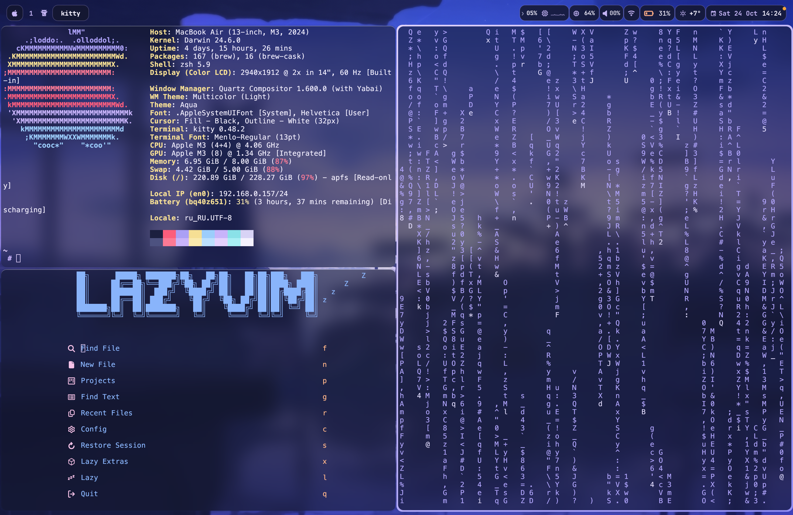

# dotfiles

My macOS setup. Tiling with yabai, a custom sketchybar, kitty, and a lavender color scheme loosely based on Arona from Blue Archive (yes, really).

Runs on a MacBook Air M3 13". Should work on other Apple Silicon Macs too, but the notch stuff is tuned for my screen, so you'll probably need to tweak a couple of numbers.



## What's in here

- `sketchybar/` — the bar. Configured in Lua, with a few small C helpers for CPU/RAM/network stats. Each group of items is its own floating "pill". There's a cava audio visualizer, a CPU graph (click it to see per-core load), RAM, Wi-Fi speed + IP, weather, and the usual stuff.
- `yabai/` — tiling config. BSP layout, some rules for dialogs and windows that shouldn't tile, plus a couple of scripts (one of them toggles float in a smarter way for apps that open lots of windows).
- `skhd/` — hotkeys, see below.
- `kitty/` — terminal. 85% opacity with blur, JetBrains Mono Nerd Font, powerline tabs, dynamically adapts to wallpaper palette.
- `borders/` — JankyBorders configuration for active window gradient and subtle inactive borders, synchronized with wallpaper colors.
- `rofi/` — not actual rofi (that's Linux only). It's a small Python launcher I wrote for apps and folders I open often, styled dynamically to match the current theme.
- `wallpaper_gallery/` — 3D Coverflow wallpaper picker written in Swift. Shows the current wallpaper title at the bottom center of the screen. Clicking the pill (or pressing `Alt + G`) opens a 3D perspective gallery to browse `~/wallpapers` (and subfolders) with live search and applies wallpapers in real time. Dynamic theme extraction instantly synchronizes Kitty, JankyBorders, Sketchybar, Yabai, and Rofi to match the wallpaper, with guaranteed restoration of the signature lavender theme for Arona.
- `square_corners/` — an Objective-C tweak that gets rid of rounded window corners. Needs Ammonia or some other DYLD injection thing. Kind of experimental, use at your own risk.
- `wallpapers/` — wallpaper collection.

## Keybinds

Everything is on `Alt` (Option).

**Focus**

| Keys | What it does |
| :--- | :--- |
| <kbd>Alt</kbd> + <kbd>H</kbd> <kbd>J</kbd> <kbd>K</kbd> <kbd>L</kbd> | focus left / down / up / right |

**Moving windows around**

| Keys | What it does |
| :--- | :--- |
| <kbd>Shift</kbd> + <kbd>Alt</kbd> + <kbd>H</kbd> <kbd>J</kbd> <kbd>K</kbd> <kbd>L</kbd> | warp window in that direction |
| <kbd>Ctrl</kbd> + <kbd>Alt</kbd> + <kbd>H</kbd> <kbd>J</kbd> <kbd>K</kbd> <kbd>L</kbd> | swap with the neighbor |
| <kbd>Alt</kbd> + <kbd>B</kbd> | balance window sizes |
| <kbd>Alt</kbd> + <kbd>R</kbd> | rotate layout 90° |
| <kbd>Alt</kbd> + <kbd>E</kbd> | toggle split direction |
| <kbd>Alt</kbd> + <kbd>M</kbd> | mirror on Y axis |
| <kbd>Shift</kbd> + <kbd>Alt</kbd> + <kbd>M</kbd> | mirror on X axis |

**Window state**

| Keys | What it does |
| :--- | :--- |
| <kbd>Alt</kbd> + <kbd>Space</kbd> | toggle float |
| <kbd>Alt</kbd> + <kbd>F</kbd> | fullscreen zoom |
| <kbd>Alt</kbd> + <kbd>W</kbd> | close window |
| <kbd>Ctrl</kbd> + <kbd>Alt</kbd> + <kbd>←</kbd> <kbd>→</kbd> | resize width |
| <kbd>Ctrl</kbd> + <kbd>Alt</kbd> + <kbd>↑</kbd> <kbd>↓</kbd> | resize height |

**Apps & spaces**

| Keys | What it does |
| :--- | :--- |
| <kbd>Alt</kbd> + <kbd>Enter</kbd> | new kitty window |
| <kbd>Cmd</kbd> + <kbd>Space</kbd> or <kbd>Alt</kbd> + <kbd>D</kbd> | launcher |
| <kbd>Alt</kbd> + <kbd>G</kbd> | 3D wallpaper gallery |
| <kbd>Alt</kbd> + <kbd>1</kbd>…<kbd>4</kbd> | go to space 1–4 |

## Installing

You'll need [Homebrew](https://brew.sh) first. Then:

```bash
brew tap FelixKratz/formulae
brew install koekeishiya/formulae/yabai koekeishiya/formulae/skhd
brew install felixkratz/formulae/sketchybar borders cava jq
brew install --cask kitty font-jetbrains-mono-nerd-font

# icon font for sketchybar
curl -L https://github.com/kvndrsslr/sketchybar-app-font/releases/latest/download/sketchybar-app-font.ttf \
  -o ~/Library/Fonts/sketchybar-app-font.ttf
```

Then clone the repo and run the script:

```bash
git clone https://github.com/Mellvazoa/dotfiles.git ~/dotfiles
cd ~/dotfiles
./install.sh
```

The script just symlinks the folders into `~/.config/` and builds the sketchybar helpers. If you already have configs there, it won't delete them — it renames them to `*.bak.<timestamp>`.

After that, restart everything:

```bash
yabai --restart-service
skhd --restart-service
sketchybar --reload
```

If you want the square corners too (needs Ammonia or similar):

```bash
cd square_corners
make
sudo make install
```

## Colors & Dynamic Theming
 
All desktop components dynamically adapt to the currently applied wallpaper using real-time pixel color extraction:
- **Kitty**: Theme colors, cursor, active tab, selection, and terminal background tint.
- **JankyBorders**: Active window gradient border (`active_color`) and inactive background border (`inactive_color`).
- **Yabai**: Active window insertion feedback border (`insert_feedback_color`).
- **Sketchybar**: Pill borders, popups, icons, and accent highlights.
- **Launcher**: Popup background and accent color.

### Arona Baseline Palette
For wallpapers matching Arona, the original signature handcrafted palette is strictly preserved:

| | Hex | Used for |
| :--- | :--- | :--- |
| lavender | `#c8b4fa` | accent, borders, active tab, cursor |
| dark navy | `#14172f` | terminal and popup background |
| bar background | `#131630` @ 85% | sketchybar pills |
| off-white | `#f0edfc` | text, icons |
| cyan | `#8ae1e8` | secondary accent |
| pink | `#fc7a95` | warnings, low battery |

## About the notch

The app menu in sketchybar gets split into two halves so nothing ends up hidden behind the notch. On my Air the notch goes from about x=646 to x=825, so the first 9 menu items (App through Window) sit to the left of it, and everything from Help onward goes to the right. If an app doesn't have that many menu items (like Finder), the right half just doesn't show up.

If your Mac has a different screen size, these numbers are what you'll need to change.
